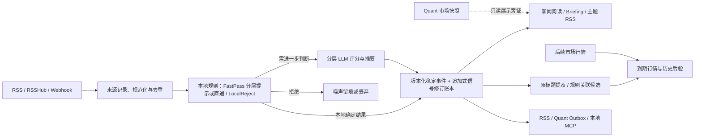

# AI-RSS-Filter

[](https://github.com/topboyshen/ai-rss-filter-public/actions/workflows/ci.yml)

> 面向 A 股研究的 AI 财经情报与新闻阅读工具。

这是经过脱敏的独立公开代码起点，原私有仓库及其历史证据仍保留。
不附带生产数据库、新闻采集批次、模型原始输出或私人持仓；示例域名不提供在线演示。
公开与 CI 不会自动部署。详见[公开分发边界](docs/public-distribution.md)。

AI-RSS-Filter 聚合 RSS、RSSHub 与 Webhook 财经信息，通过本地规则和分层
LLM 路由辅助筛选，提供新闻首页、主题简报、事件雷达及质量与运维视图。
目标是让重要信息更容易发现、减少重复与表达误导，并能追溯到来源记录、评分契约
和映射版本。证券关联与历史后验用于辅助核对，不证明个股受益或可交易收益。

部署后的页面入口：新闻首页 `/`、事件雷达 `/events`、模型质量 `/quality`、运维面板 `/ops`。

> 本项目只输出情报和历史旁证，不执行交易，不构成投资建议。Quant 市场数据、
> 模型质量结论不能回写既有评分或自动修改生产策略。

## 为什么做这个项目

财经快讯的主要问题不只是数量多，还包括同一事件重复转载、来源质量不同、文章时间与
真正可用时间混淆，以及“高分”缺少后验检验。AI-RSS-Filter 将这些问题拆成三层：

1. **筛选层**：统一接入、来源规则、本地快速判断和成本受控的模型评分。
2. **事件层**：满足严格合并条件的报道归并为稳定事件；未满足硬归并条件但达到
   相似门槛的关系可逆保留。
   证券关联保留证据与版本，不把相似度当作事实证明。
3. **验证层**：冻结当时可见的数据，按策略与映射版本独立积累后验，不用今天的规则
   重写昨天的结果。

## 如何阅读与核对

在配套的 Glance 新闻与研究面板中：

- **先读具体新闻**：标题、来源与北京时间“收录”时间优先；方向、入选依据及规则池
  默认折叠，桌面与手机均可展开。收录时间不是新闻首发时间。
- **用简报查看主线**：预览复用主题中的既有代表新闻，保留原文链接与来源限制；
  可展开查看全部主题，不为填满页面编造内容。
- **分清公司提及与主题示例**：标题提及使用最终原始标题和活跃 A 股证券主档消歧；
  无法确认唯一身份时不关联，原标题缺失或主档读取失败时显示未知／不可用，新闻仍可展示。
  主题规则池中的个股只是示例，不代表本文点名；即使明确提及，也不代表推荐或受益。
- **查处理原因与质量边界**：模型质量视图区分评分与映射契约、样本不足和未知状态；
  登录后可查看保守处理的已记录原因。原因类别与处理计数不是模型准确率或误拒率。
- **核对数据状态**：启用快照的生产 Web 默认卡片路径读取 Worker 发布的最近成功产物，
  请求本身不触发采集、模型调用或现场快照计算。超龄／未来时间显示过期或异常提示；
  产物缺失、损坏或版本不匹配显示不可用。自定义参数、本地开发或关闭快照时可能走实时路径。
  HTTP 200 或容器健康本身不能证明新闻刷新成功。

首页还按时间窗、去重和来源配额选卡，且快照未必已反映最新输入：
**未显示不能据此判断未采集、未评分或没有研究价值**。
分数与方向是系统输出，不是已验证的准确率、投资胜率或收益预测。
Glance 的布局、样式和应用镜像需分别安装生效；仓库主线有代码也不代表某个站点已部署。

## 工作流程



生产环境由 Flask/Gunicorn API、后台 Worker、Redis AOF 共享缓存、SQLite 与 Nginx
网关组成。仓库提供轮询式 HTML widget 和 RSS；
外部部署可用 Glance 展示，并用 Miniflux 作为深度阅读与 Webhook 入口。

## 核心模块与边界

| 模块 | 回答的问题 | 主要输出 | 会改变 AI 筛选吗 |
|---|---|---|---|
| 多源接入与评分 | 哪些信息值得进入情报流 | 分数、标签、方向、评分路径 | **是，这是唯一筛选主路径** |
| 今日情报 Briefing | 今天有哪些主线，为什么现在重要 | 主题配额、事实锚定、来源链接 | 否，只组装已评分结果 |
| 事件与证券关联 | 原始标题与留存证据关联到哪些主题和证券 | 标题提及、规则主题及版本化关系候选 | 否，不改原始分数 |
| 模型质量 | 评分与映射后验是否成熟 | 样本进度、版本账本、门槛状态 | 否，不自动应用策略 |
| AI × Quant | AI 方向是否得到市场侧旁证 | 风险、波段与一致性状态 | 否，严格展示旁路 |
| RSS / HTML / MCP / Outbox | 外部系统如何消费结果 | 订阅流与只读接口 | 否，只消费或传递已形成结果 |

Briefing 在评分和事件去重之后执行主题配额与本地事实锚定（grounding）；不受原文
支持的评论字段会降级为空白或确定性文案。

标题提及、主题背景与评分理由分开展示；前向事件映射只读取发布方原标题，不以生成
摘要、标签或理由充当原文证据。历史存档摘录不自动改写，也不作为已核验原文。
来源分层与出版方分组不等于一手来源已核验或多源独立确认。

## 数据可信度设计

- **按可用时间冻结**：信号保存事件版本、分数、方向、入选状态、策略指纹、映射版本和
  实际可用时间，避免未来函数。
- **按契约隔离**：评分规则或反馈变化时形成新的评分契约队列，映射变化时形成新的映射
  契约队列；旧契约只作历史参考，不混入当前正式结论。
- **先积累再发布**：样本数、独立事件、独立结果交易日或证券覆盖不足时，页面显示
  “样本不足”，隐藏精确胜率和收益结论。
- **探索视图不解锁调参**：显式全分数查询只用于观察，不能冒充已独立结算的
  入选/未入选对照。
- **后验不等于因果**：映射证据覆盖不代表语义准确率/召回率（precision/recall）；
  市场表现只能说明历史关联。
- **不是交易回测**：展示收益未计手续费、滑点、跳空和成交约束，不能解释为可执行收益。
- **校验通过不等于效果验证**：自动化测试、格式校验和来源锚定不能替代人工标注、
  真实样本审查及留出验证；不据此宣称模型已变准或重要资讯已全部覆盖。
- **永不自动应用**：质量模块只提供状态和候选路线，生产阈值、来源规则及映射关系仍需
  人工审查、留出验证和影子验证。

完整口径见[模型质量与数据契约](docs/model-quality.md)。

## 快速开始

### 本地 API 开发

需要 Python 3.11（CI 验证版本）。下面的最小启动可验证 API 和数据库初始化，
不会自动启动完整的 Redis、RSSHub 与 Worker 拓扑。

```bash
git clone https://github.com/topboyshen/ai-rss-filter-public.git
cd ai-rss-filter-public

python3.11 -m venv .venv
. .venv/bin/activate
python -m pip install -r requirements.txt

export AI_FILTER_ROLE=web
export AI_FILTER_DB_PATH="$PWD/data/dev-cache.db"
export AI_FILTER_API_KEY="$(openssl rand -hex 32)"

python app.py
```

另开终端验证：

```bash
curl -fsS http://127.0.0.1:5000/health
curl -fsS 'http://127.0.0.1:5000/feed/rss?min_score=8&hours=48'
```

新数据库尚未由 Worker 导入资讯时，第二个请求会返回结构合法但没有条目的 RSS，这是
预期结果，不代表启动失败。需要持续采集和异步评分时，请部署完整生产拓扑。

`app.py` 不会自动读取 `.env`。本地开发请显式导出环境变量；生产 Docker Compose 将
`.env` 用作插值输入，仅把各角色需要的凭据显式投影到容器。行为参数随 `config.yaml`
和 Compose manifest 发布。未配置 LLM Key 时，本地规则仍可工作，但模型评分、复核和
摘要能力会降级。Quant 与 Telegram 均为可选能力。

### 完整生产部署

生产使用不可变镜像引用和归档 Compose manifest：

首次在发布主机准备独立的 Python 3.11 门禁环境（不要复用旧的 3.10 `.venv`）：

```bash
python3.11 -m venv .venv-release-gate
.venv-release-gate/bin/python -m pip install -r requirements.txt
```

隔离测试和正式发布测试默认共用 `.venv-release-gate/bin/python`，不会回退到开发用的
`.venv` 或宿主机 Python。只运行测试时，在干净 checkout 中使用：

```bash
./scripts/run-release-tests.sh focused  # 发布脚本相关测试
./scripts/run-release-tests.sh full     # 完整测试及覆盖率
```

两种入口都保留 `AI_FILTER_TEST_PYTHON=/绝对路径/bin/python` 显式覆盖，适用于 CI 或
已准备好的独立环境。依赖按 `requirements.txt` 安装，其中 Redis 客户端固定为
`redis==8.0.1`。直接执行 `pytest` 使用当前 shell 的解释器，不会自动切换虚拟环境；
`run-release-tests.sh` 的成功结果不生成正式发布收据。

准备好环境后，按[日常操作入口](ops/DAILY-OPS.md)依次执行发布门禁、`build`、`deploy`、
`verify`；该页集中维护完整命令和基于 `current`/`previous` 的回退步骤。

`run-release-gate.sh` 会在隔离的 clean-HEAD worktree 中，以项目的 Python 3.11
环境执行完整测试和 75% 覆盖率门槛。只有成功才会在 `/run` 写入短期、本机、
owner-only 的发布测试收据；`build` 在收据缺失、过期、源码/runner/Python 不匹配时
于调用 Docker 前拒绝。该收据用于防止漏跑或误用旧测试结果，不是抵抗 root 的密码学签名。
dirty build 与外部 Compose build 均不被收据授权；部署和回滚不重新运行测试。

部署前需要 `.env`、三个相互独立的 Docker service secrets、Redis/RSSHub 以及持久化数据
目录。应用镜像回滚不会自动回滚 SQLite；请先阅读
[部署、迁移与恢复](docs/deployment-and-recovery.md)。

## 常用只读接口

| 接口 | 认证 | 用途 |
|---|---|---|
| `GET /glance-sse` | 无 | 启用快照时读取默认生产新闻首页产物 |
| `GET /briefing-card?min_score=7&limit=12` | 无 | 启用快照时读取默认生产简报预览产物 |
| `GET /feed/rss` | 无 | 从数据库缓存导出最低分与主题切片 |
| `GET /events/rss` | 无 | 按事件重要度和方向导出事件 RSS |
| `GET /briefing?format=html` | 无 | 今日主题 Briefing |
| `GET /score-backtest` | 无 | 评分与个股映射后验状态 |
| `GET /event-radar-card` | 无 | 只读事件雷达卡片 |
| `GET /dashboard` | API Key 或浏览器 Session | 管理面板、成本与反馈 |
| `GET /dashboard/neutral-records` | API Key 或浏览器 Session | 有界查看当前评分契约的保守处理记录 |
| `GET /integration/v1/signals` | 独立 Bearer token | AI → Quant 不可变信号修订流 |

订阅示例：

```text
/feed/rss?min_score=8&theme=芯片国产化&hours=48&limit=30
/events/rss?min_score=7&direction=看多&hours=24&limit=30
```

未知主题返回合法空 Feed；非法分数或方向返回 400，不触发实时抓取或模型调用。
事件卡片与 `/events/{json,rss,html}` 只展示对读者有意义的事件内容，不暴露内部回放队列或账本。
AI ↔ Quant 的双向边界、游标和恢复语义见 [Quant 集成契约](docs/quant-integration.md)。

## 配置分工

- [`.env.example`](.env.example)：环境变量参考；生产 Compose 只投影所需凭据，行为参数见 `config.yaml` 与 `docker-compose.yml`。不要提交真实 `.env`。
- [`config.yaml`](config.yaml)：信息源、来源门槛、模型路由、Briefing 主题与本地规则。
- `secrets/`：Dashboard Session、AI → Quant、Quant → AI 三个独立服务凭据；不要复用。
- [`docker-compose.yml`](docker-compose.yml)：生产服务拓扑、健康检查和资源边界。

## 仓库结构

| 路径 | 职责 |
|---|---|
| `core/` | 评分、提示词、Briefing、主题与资产规则 |
| `db/` | SQLite 数据访问、稳定事件核心与 Outbox |
| `routes/` | HTTP、Dashboard、Feed、Webhook 与集成接口 |
| `services/` | 后验、事件查询、Quant 旁证和后台服务 |
| `workers/` | 收盘行情与证券主数据采集 |
| `ops/` | systemd、备份、恢复演练、监控与漂移检查 |
| `tests/` | 单元、集成、安全、迁移与发布测试 |

## 文档导航

- [文档索引](docs/index.md)
- [新闻首页、手机布局与配套 Glance 配置](ops/GLANCE-READING.md)
- [模型质量与数据契约](docs/model-quality.md)
- [保守处理记录与登录入口](docs/neutral-records.md)
- [Quant 集成契约](docs/quant-integration.md)
- [部署、迁移与恢复](docs/deployment-and-recovery.md)
- [日常操作入口](ops/DAILY-OPS.md)
- [主机运维](ops/README.md)

## 测试

```bash
python -m pytest
```

生产发布前还应在 Linux 上执行全量测试，以覆盖 `flock`、`/proc`、systemd/cron 资产和
发布脚本语义。

## 许可证状态

仓库目前未附独立 `LICENSE` 文件。README 不替代正式授权文件；在维护者选择并提交明确
许可证之前，请勿仅依据历史说明推定复制、分发或商用授权。
